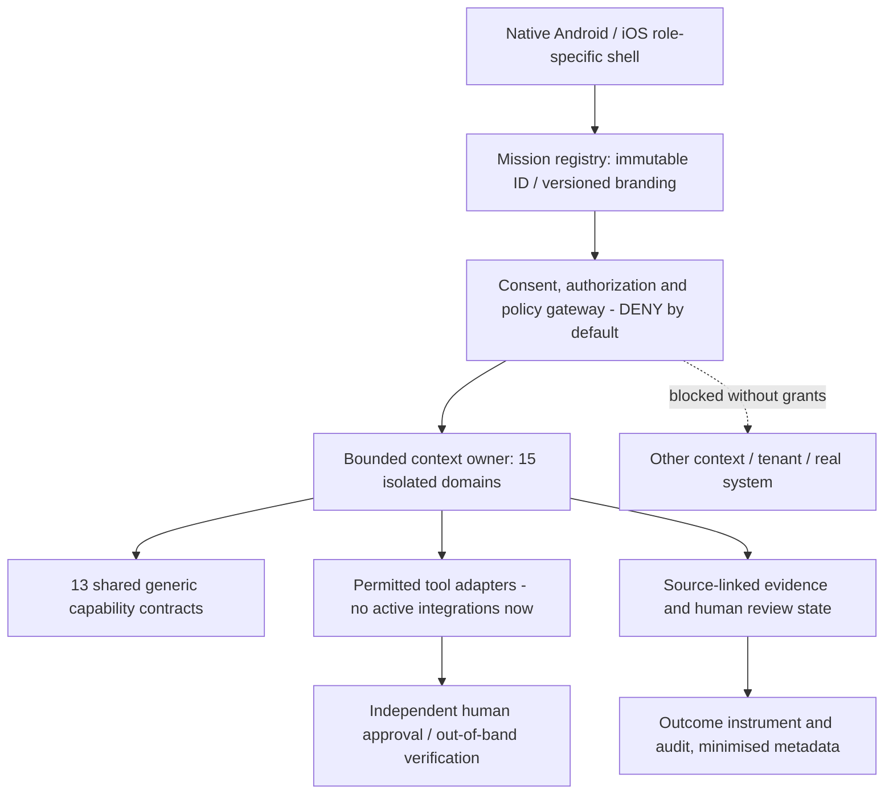

# ADR-173-01 — Pre-investment Dubai 150 target architecture

**Status:** ACCEPTED AS RESEARCH-ARCHITECTURE PROPOSAL, **NOT** production approval.
**Date:** 2026-10-29. **Supersedes:** the assumption that 150 source files imply 150 independent agents. **Depends on:** Stage172 redundancy review. **Scope:** all 150 canonical IDs.

## Decision

Maintain **150 stable mission identities** as the research/award hypothesis registry, but **do not fund 150 separate runtime engines or release targets now**. Instead design:

- **15 domain bounded contexts**, each with ownership of its data, role policy, workflow invariants, domain validators and business outcomes. One mission has exactly ONE primary context; cross-context dependencies use an explicit minimal versioned interface, never shared mutable tables.
- **13 reusable capability contracts** for generic mechanics such as source reading, draft creation, case ledger, schedule, verification, steps, matching, journal, stock quantities, audit ledger, journey, comparison and learning. A capability is a *library/service primitive*, not an independent award entry.
- **150 mission definitions**, keyed by immutable `AE/PE/BU-NN` IDs. Each definition identifies its primary bounded context, one primary capability, actor boundary, source claims, risk and outcome. Brand names, translations and device route labels are versioned metadata, not foreign keys.
- **A small set of native Android and iOS application shells / role-specific clients**, count **TBD** after observed users and commercial/legal needs. One shell may host many missions; distinct apps need independent economic, UX and security justification. No presumption of 150 app stores or packages.

**Separation of concerns:** Product identities (150) ≠ domain contexts (15) ≠ reusable capabilities (13) ≠ installed applications (undetermined) ≠ working agentic workflows (not yet approved).

### Logical diagram



## Architectural responsibility boundaries

- **Bounded context** is where domain truth and qualified approvals live. E.g. food-safety decision is never delegated to a generic checklist; clinical advice stays outside the Health Administration scope.
- **Reusable capability** provides non-domain-specific mechanics but cannot silently become an authority: a source reader cites original text; a planner proposes reversible actions; a verifier records human/source confirmation, not its own guessed 'verified' label.
- **Mission** composes a context-owned workflow with only explicitly authorized capabilities. It must show a *distinct real-world task, concrete affected beneficiary/buyer, and measurable outcome* before becoming a product.
- **Brand and platform client** display the mission; they must not own irreversible business logic, eligibility rules or shared account credentials.
- **Tool gateway** enforces contextual permission, actor/tenant/subject scope, purpose, consent, expiration, idempotency, approval and safety rules. The LLM is not an authorizer and must not create permissions or claim side effects.
- **Evidence store and audit** use separated retention and encryption boundaries per context/tenant. No cross-user searchable transcript or centralized child/health/staff data lake.

## Domain inventory and taxonomy provenance

See `bounded_contexts_15.csv`. All **69 source taxonomy domain labels** from Stage172 are covered exactly once, assigned in `agent_to_context_150.csv` to all 150 agents. Context ownership is a starting architecture decision subject to domain-expert revision; it does NOT measure independent demand. The contexts are:

BC01 Inclusive Content & Communication; BC02 Accessible Journeys & Places; BC03 Care, Household & Family; BC04 School & Learning; BC05 Workforce & Occupational Safety; BC06 Property & Facility Operations; BC07 Food & Circularity; BC08 Climate, Warnings & Sustainability; BC09 Official Service & Credentials; BC10 Consumer Finance & Safety; BC11 Enterprise Finance & Procurement; BC12 Customer Service & Enterprise Governance; BC13 Consented Community Assistance; BC14 Logistics & Chain of Custody; BC15 Health Administration.

`reusable_capabilities_13.csv` enumerates **13 contracts**, mapped from all 37 operation labels, and tagged **DESIGN_ONLY/NO_REAL_TOOLS**. This is not 13 actually implemented secure AI agents.

## Capability contract and data flow

For any mission action:

1. **Request** includes `mission_id`, versioned `mission_definition`, actor, owner context, tenant or self-scope, purpose, minimal inputs and explicit idempotency key. Identify capability and tool; never choose unrestricted tools.
2. **Source** is stored as an evidence reference with source type, version, captured time, original jurisdiction, reviewer and uncertainty. Untrusted text/LLM output is treated as data, never as a system instruction. No source = UNKNOWN, never fabricated CONFIRMED.
3. **Plan** is a user-visible, reversible sequence of proposed actions with stated preconditions, side effects, risks, expected value, costs, fallback and ability to cancel.
4. **Policy check** gates each read/compute/write action separately. In the current research stage, real-world tool effects are **always denied**, regardless of an apparent consent check box.
5. **Human approval** is context-specific: for repairs tenant/service owner; for invoices AP controller; for accessibility physical inspection/venue contact; for food safety qualified reviewer; for school authorized staff/guardian. Human reviewer may reject or correct and should not be bypassed by an AI model.
6. **Execution** can only occur in an explicitly authorized later milestone with scoped tool adapter and stable audit log. No blanket 'approve all' and no direct LLM network credentials.
7. **Verification** records the actual external result or informed refusal; success is a measured real-world event, not the draft status or a generated explanation. Failure must have a recovery/rollback or safe stop.
8. **Measurement** captures outcome and comparator under a documented research protocol, including negative cases, costs and uncertainty.

### Event contract (proposed, not implemented in app)

```json
{
  "event_version": "1.0",
  "mission_id": "AE-24",
  "context_id": "BC06",
  "event_type": "EvidenceQuestionPrepared",
  "actor_scope": "resident",
  "reference_id": "fictional-example-only",
  "evidence_state": "UNKNOWN",
  "requires_user_review": true,
  "sensitivity": "RESTRICTED",
  "payload": {"summary": "redacted-only"}
}
```

A cross-context consumer must **request and obtain its own authorization**; the producing context must not make the recipient authorized merely by publishing an event. Prefer event IDs, hashes and minimal redacted facts, not raw invoice, clinical, school or employee records. Define retention, regional data residency, revocation and deletion before real integration.

## Three explicit end-to-end product boundaries

**A. Accessibility / venue (AE-10 JALIS + PE-35 TAHAQQOQ + BU-34 MUYASSAR):**
- Shared capability: verify evidence and maintain provenance.
- BC02 owns visitor requirements and venue condition read-model; BC02 may pass a purpose-limited accessibility issue to BC06 or facilities system **only if owner/user and recipient grants exist**. Internal BU-34 venue remedial authority ≠ visitor trust.
- User-facing evaluation: "Is the lift confirmed accessible today?" must remain UNKNOWN until authoritative confirmation. No invented map barrier or accessible route.

**B. Property maintenance (AE-21 NADAA + AE-23 NUR + AE-24 HADAR + BU-01 IGLAQ + BU-31 TABRID + BU-32 ISLAH):**
- BC06 owns one domain `MaintenanceCase` lifecycle with separate resident, technician and manager role views and issue specialization (water/cooling/general). A ticket marked CLOSED without tenant-accepted evidence becomes DISPUTED rather than VERIFIED.
- Payments, tenancy legal decisions, utility account access and live DEWA alerts remain outside system until separately contracted permissions. Do **not** create six independent ticket databases.

**C. Business invoices (BU-06 TASWIYA + BU-08 TATABUQ + BU-10 TANBIH):**
- BC11 owns a single `InvoiceException` aggregate with subtype (PO/receipt mismatch, recurring charge, supplier dispute), an evidence packet and explicit AP-controller review.
- Financial write actions, posting, vendor bank changes and payment approval are never inferred from LLM output. Test whether incumbent ERP already supports the journey: if yes, **stop a standalone product**.

## Threat model: explicit non-negotiables

| Threat | Boundary and architecture invariant |
|---|---|
| Prompt injection in documents/email/tool output | Separate untrusted content from instructions; explicit policy contracts; test malicious source content and deny escalation |
| Excessive agency / unintended side effect | Default-deny tool registry, short-lived scopes, signed human approval for consequential actions, resource allowlists, idempotency |
| Cross-tenant/role leakage | No shared credentials or mutable domain database; per-tenant keys and authorization on *every* read, not only screen visibility |
| AI fabrication of source, accessibility, legal rights or completion | Evidence provenance and status UNKNOWN unless independently confirmed; no model self-certification |
| Insecure inter-agent communication | Schema-validated redacted events with owner checks and no trust inherited across contexts |
| Irreversible third-party action | Human release, dry-run preview, verified action receipt, rollback/compensation where feasible |
| Child/health/workplace/financial information mishandling | Restricted-by-default context privacy; data minimization, access revocation, consent and independent qualified expert review |
| Multi-language and mobile access barriers | Native RTL/Arabic voice and TalkBack/VoiceOver tests plus WCAG 2.2 mapping as reference; draft WCAG2Mobile is informative, **not** certification |
| Conflicting brands and renamed missions | ID immutability, alias registry, references and mobile route migration as explicit ADR; no deletion of past provenance |

Relevant public engineering guidance used as **supporting controls, not regulatory certification**: [NIST AI RMF Generative AI Profile](https://www.nist.gov/publications/artificial-intelligence-risk-management-framework-generative-artificial-intelligence), [OWASP Top 10 for Agentic Applications 2026](https://genai.owasp.org/resource/owasp-top-10-for-agentic-applications-for-2026/), [W3C WCAG 2.2](https://www.w3.org/TR/WCAG22/) and [WCAG2Mobile in-progress mobile mapping](https://www.w3.org/TR/wcag2mobile-22/).

## Explicitly rejected approaches

1. **150 one-off agent runtimes immediately**: replicates incomplete engines, raises cost and risk, and creates 150 unverified product bets.
2. **One super-agent with full access to everything**: destroys domain and consent boundaries, increases blast radius and creates poor evidence integrity.
3. **One global account/tenant/people database**: unacceptable sensitive-data and governance coupling.
4. **Automatic merger of all 45 overlap groups**: overlaps concern *some* tasks; actor rights, regulatory constraints and real outcomes may differ.
5. **Using name uniqueness or number of source files as award readiness**: technically/empirically unsupported.
6. **LLM or generated content as authoritative reviewer**: cannot approve safety, legal, school, payment or medical outcomes.

## Consequences and stopping criteria

Positive: stable provenance and optional rebranding; shared engineering investment only after genuine demand; fewer duplicated source-reading, task and ticket components; context-isolated tests.

Costs/tradeoffs: contextual policies and event schemas demand real design; cross-context workflows require product and security reviews; multiple platforms and languages impose accessibility burden. No claimed monetary savings without measured cost model.

**Pre-investment freeze:** No new mass-generated mission module count, tool integrations, agent autonomy, app store targets or risky third-party operations until the gates documented in `BUILD_DECISION.md` are cleared. Continue low-cost documentary research, user-discovery planning and synthetic security architecture tests. No automatic portfolio deletion or business reorganization.

**Acceptance of THIS ADR** means agreement to a plan for research and safe architecture only. **All 150 remain RESEARCH_HOLD.** 
